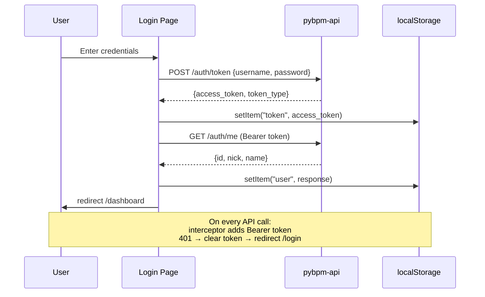
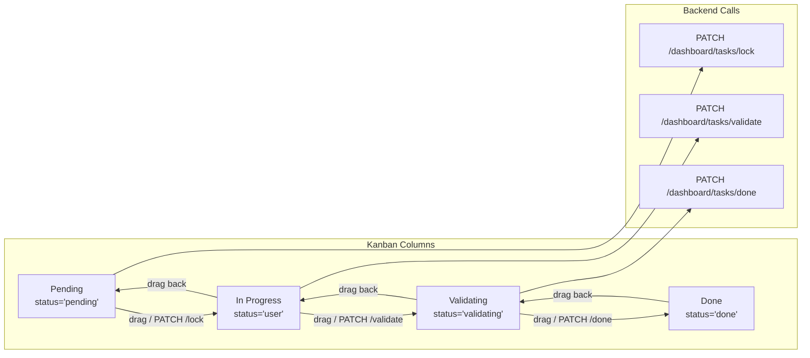

# PyBPM UI

**Dashboard & Task Management Frontend** — a Next.js 16 application providing the user-facing dashboard, inbox, and task management interfaces for PyBPM.

## Architecture

### System Architecture

```mermaid
graph TB
    subgraph Browser["Browser (User)"]
        LP[Login Page<br/>/login]
        DP[Dashboard Home<br/>/dashboard]
        TP[Task Kanban<br/>/dashboard/tasks]
        IP[Inbox<br/>/dashboard/inbox]
        MP[Message Detail<br/>/dashboard/inbox/message/[id]]
    end
    
    subgraph Frontend["Next.js 16 App Router (Port 3000)"]
        REW[Rewrite Rules<br/>/api/v1/* → backend]
        
        subgraph Components["React Components"]
            RC[@tanstack/react-query]
            MUI[MUI v9 Components]
            DND[@dnd-kit Drag & Drop]
            LUC[lucide-react Icons]
            TM[Theme Context<br/>light/dark]
        end
        
        subgraph Shared["src/"]
            AC[api/client.ts<br/>axios + interceptors]
            AU[src/hooks/useAuth.ts]
        end
        
        subgraph Pages["app/"]
            LP2[login/page.tsx]
            DL[dashboard/layout.tsx]
            DP2[dashboard/page.tsx]
            TP2[dashboard/tasks/page.tsx]
            IP2[dashboard/inbox/page.tsx]
            MP2[inbox/message/[id]/page.tsx]
        end
        
        REW --> Components
        Components --> Shared
        Pages --> REW
    end
    
    subgraph Backend["pybpm-api FastAPI (Port 5000)"]
        AU2[Auth<br/>/api/v1/auth/*]
        DS[Dashboard<br/>/api/v1/dashboard/*]
        IB[Inbox<br/>/api/v1/inbox/*]
        EN[Engine<br/>/api/v1/bpm/engine/*]
        RP[Repository<br/>/api/v1/bpm/repository/*]
    end
    
    LP -->|POST /auth/token| AU2
    DP -->|GET /dashboard/*| DS
    TP -->|GET/PATCH /dashboard/tasks/*| DS
    IP -->|GET/POST /inbox/*| IB
    MP -->|GET/PUT/DELETE /inbox/*| IB
    
    style Frontend fill:#e8f5e9
    style Backend fill:#f3e5f5
```

### Authentication Flow



### Dashboard Tasks Kanban Flow



### Inbox Message Flow

```mermaid
flowchart TD
    subgraph Inbox["Inbox Page"]
        FOLD[Folder Tabs:<br/>Inbox / Sent / Trash]
        FILTER[Filter: all / read / unread]
        PAG[Pagination]
    end
    
    subgraph Message["Message Detail"]
        READ[Mark as read]
        STAR[Toggle star]
        DEL[Move to trash]
        REP[Reply (stub)]
    end
    
    FOLD -->|GET /inbox/filter| API
    FILTER --> API
    PAG --> API
    
    API --> MSG["Message Object"]
    MSG --> READ
    MSG --> STAR
    MSG --> DEL
    MSG --> REP
    
    style Inbox fill:#fff3e0
    style Message fill:#e3f2fd
```

## Tech Stack

| Layer | Technology |
|-------|-----------|
| Framework | Next.js 16 (App Router, React Server Components) |
| Language | TypeScript 5.6 |
| UI Library | MUI v9 (Material UI) |
| State Management | @tanstack/react-query v5 |
| HTTP Client | Axios (with interceptors) |
| Drag & Drop | @dnd-kit/core + @dnd-kit/sortable |
| Styling | Tailwind CSS v4 + Emotion (MUI) |
| Icons | lucide-react |
| Theming | Custom dark/light mode via ThemeContext |
| Testing | Playwright (E2E) |
| Linting | ESLint + TypeScript ESLint |
| Formatting | Prettier |

## Project Structure

```
pybpm-ui/
├── app/
│   ├── layout.tsx           # Root layout — wraps Providers
│   ├── page.tsx             # Root redirect → /login
│   ├── providers.tsx        # QueryClient + MUI Theme + ThemeContext
│   ├── globals.css          # Tailwind CSS import
│   ├── login/
│   │   └── page.tsx         # Login form (MUI Card + TextField)
│   └── dashboard/
│       ├── layout.tsx       # Dashboard shell — AppBar + Drawer nav
│       ├── page.tsx         # Dashboard home — stats cards
│       ├── tasks/
│       │   ├── page.tsx     # Kanban board (pending/in-progress/validating/done)
│       │   └── TokenTypeIcon.tsx # Token type icons (events, gateways, tasks)
│       └── inbox/
│           ├── page.tsx     # Inbox message list (folder filter, pagination)
│           └── inbox/message/[id]/
│               └── page.tsx # Message detail (read, star, delete)
├── src/
│   ├── api/
│   │   ├── client.ts        # Axios instance with auth interceptors
│   │   └── README.md        # API client documentation
│   └── hooks/
│       └── useAuth.ts       # Auth hook (login, logout, user state)
├── public/images/icons/       # BPMN token type icons (events, gateways, tasks)
├── tests/e2e/
│   ├── auth.spec.ts         # Login flow tests
│   ├── inbox.spec.ts        # Inbox tests
│   ├── tasks.spec.ts        # Task management tests
│   ├── test-tasks-count.spec.ts
│   └── helpers/auth.ts      # E2E auth helper
├── next.config.mjs          # Rewrites to backend API
├── eslint.config.mjs
├── postcss.config.mjs
├── tsconfig.json
├── package.json
├── Dockerfile               # node:22-alpine
├── docker-compose.yml       # Dev server (port 3000)
├── playwright.config.ts     # E2E test config
├── start-dev.sh             # Dev startup script
└── .env / .env.example      # Environment configuration
```

## Pages & Features

### Login Page (`/login`)

- MUI Card with centered form
- Username (nick) + password fields
- Error display via MUI Alert
- Redirect to `/dashboard` after login (or from `?redirect=` param)
- Token stored in `localStorage`
- Uses `Suspense` for search params

### Dashboard Home (`/dashboard`)

- Welcome message with user's nick
- Stats cards: Total Cases, Open Cases, Closed Cases
- Fetches counts from `/api/v1/dashboard/cases/count`
- Auth check via `useAuth()` — redirects to `/login` if unauthenticated

### Tasks Kanban (`/dashboard/tasks`)

- Four-column Kanban board: **Pending → In Progress → Validating → Done**
- Task cards with:
  - Task type icon (User, Manual, Script, Send, Receive, BusinessRule)
  - Case name and model name
  - Relative date
  - Progress indicator (elapsed time)
- Drag-and-drop between columns via `@dnd-kit`
- Status transitions:
  - Pending → In Progress: `PATCH /dashboard/tasks/lock`
  - In Progress → Validating: `PATCH /dashboard/tasks/validate`
  - Validating → Done: `PATCH /dashboard/tasks/done`
- Lock/unlock for concurrency control
- Data fetched from `/api/v1/dashboard/tasks/list`

### Inbox (`/dashboard/inbox`)

- Folder tabs: Inbox, Sent, Trash
- Per-folder count badges
- Message list with:
  - Subject, sender, date, tag
  - Star/unstar toggle
  - Read/unread indicator
  - Pagination
- Filter by: all, read, unread
- Data fetched from `/api/v1/inbox/filter/`

### Message Detail (`/dashboard/inbox/message/[id]`)

- Full message body display
- Star/unstar toggle
- Delete (move to trash)
- Reply button (stub)
- Mark as read on load
- Back navigation

## Authentication Flow

### Auth Interceptor (`src/api/client.ts`)

Every outgoing request is intercepted:

```typescript
// Request interceptor
api.interceptors.request.use((config) => {
  const token = localStorage.getItem("token");
  if (token) {
    config.headers.Authorization = `Bearer ${token}`;
  }
  return config;
});

// Response interceptor
api.interceptors.response.use(
  (response) => response,
  (error) => {
    if (error.response?.status === 401) {
      localStorage.removeItem("token");
      window.location.href = "/login";
    }
    return Promise.reject(error);
  }
);
```

### useAuth Hook

```typescript
// Login
const { login, logout, user } = useAuth();
await login(nick, password);  // stores token in localStorage

// Logout
logout();  // clears token and user state

// Check auth
if (!user) return <Redirect to="/login" />;
```

## Theming

### Dark Mode Architecture

```mermaid
graph TB
    LC[ThemeContext<br/>shared state]
    LC -->|mode| LS[localStorage<br/>"theme"]
    LC -->|toggleTheme| LM[Light Mode]
    LC -->|toggleTheme| DM[Dark Mode]
    
    LC --> MUI[MUI ThemeProvider<br/>createTheme]
    MUI --> CT[QueryClientProvider]
    CT --> APP[Application]
    
    style LC fill:#fff3e0
    style LS fill:#e3f2fd
```

- Theme preference stored in `localStorage("theme")`
- Persists across sessions
- Toggle via AppBar theme button (☀/🌙)
- MUI `createTheme` generates palette from mode

## API Client

All API calls go through the centralized axios instance in `src/api/client.ts`:

```typescript
import api from "@/api/client";

// Auth
const loginRes = await api.post("/auth/token", formData);
const me = await api.get("/auth/me");

// Dashboard
const casesCount = await api.get("/dashboard/cases/count");
const tasksList = await api.get("/dashboard/tasks/list");
await api.patch("/dashboard/tasks/done", { resource_id });

// Inbox
const messages = await api.post("/inbox/filter/", { folder, page });
const message = await api.get(`/inbox/${id}/`);
await api.put(`/inbox/${id}/read/`);

// Engine
const runRes = await api.post(`/bpm/engine/run/${idwf}/${idcase}`);
```

## Configuration

| Variable | Default | Description |
|----------|---------|-------------|
| `PYBPM_API_URL` | `http://localhost:5000` | Backend API base URL |
| `NEXT_PUBLIC_PYBPM_API_URL` | `http://localhost:5000` | Client-accessible API URL |
| `PORT` | `3000` | Dev server port |
| `ENVIRONMENT` | `development` | Development/production mode |
| `DEBUG` | `true` | Enable debug logging |

## Development

```bash
# Install dependencies
npm install

# Set PYBPM_API_URL in .env
# e.g., PYBPM_API_URL=http://localhost:5000

# Run dev server
npm run dev
# Visit: http://localhost:3000

# Build for production
npm run build

# Start production server
npm start
```

### Testing

```bash
# Run E2E tests
npx playwright test

# Run with UI
npx playwright test --ui

# Lint
npm run lint

# Format
npm run format
```

### Docker

```bash
# Start dev server
docker compose up -d

# Visit: http://localhost:3000
```

## Design Decisions

1. **Next.js App Router**: Uses server components where possible (layout, page metadata) and client components (`"use client"`) where interactivity is needed (forms, drag-and-drop, state management).
2. **MUI v9**: Material Design components for consistent UI across all pages. Uses Emotion for CSS-in-JS styling.
3. **React Query**: Server state management via `@tanstack/react-query`. Provides caching, background refetching, and optimistic updates. Query keys are typed as const tuples.
4. **Drag and Drop**: `@dnd-kit` for the Kanban board. Cards are draggable between columns; status transitions are triggered on drop via API calls.
5. **Auth via localStorage**: Token stored in `localStorage` with axios interceptors for automatic injection. 401 responses trigger automatic redirect to login.
6. **Relative API paths**: All client calls use relative paths (`/api/v1/...`) proxied through Next.js rewrite rules. This avoids CORS issues and allows environment-independent configuration.
7. **Dark mode**: Custom `ThemeContext` with `localStorage` persistence. MUI `createTheme` generates the palette from the mode. Toggle available in the AppBar.
8. **Playwright E2E tests**: Tests cover login flow, inbox operations, and task management. Auth helper provides browser-based login for test isolation.
9. **Token type icons**: Static PNG icons in `public/images/icons/` for all BPMN token types (events, gateways, tasks).
